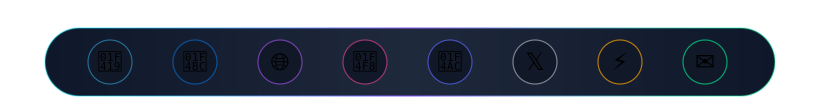

  

 

  

 

<h3 align="center">Latest Projects</h3>

  

 

<h3 align="center">Connect With Me</h3>

  

<!-- Paste your profile links inside the quotes ("") below -->

  
  
  
  
  
  
  
  

 

  

