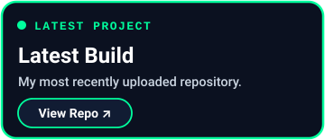
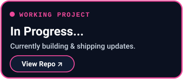
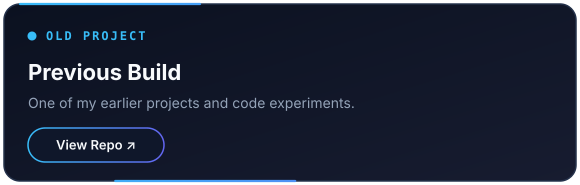
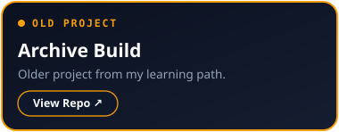

  

 

  

 

<h3 align="center">PROJECTS</h3>

<!-- Paste your GitHub repository links inside href="" below -->
<h3 align="center">Projects</h3>

  
  
  
  

 

<h3 align="center">Connect With Me</h3>

<!-- All-in-One Animated Dock: Paste your links inside href="" below -->

  
  
  
  
  
  
  

 

  

